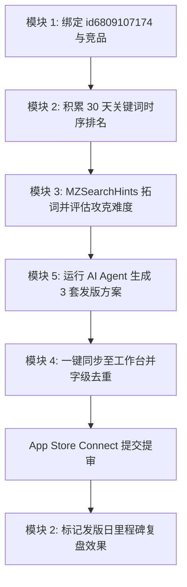

# 个人轻量级 ASO 监控与优化工具 — 详细使用手册 (USER_GUIDE)

> **版本**：V1.0 MVP  
> **适用对象**：独立开发者、中小研发团队、ASO 运营人员  
> **核心特色**：零成本架构、Apple 官方接口真机模拟、30天倒序趋势看板、100字符智能字级去重、AI 决策推荐闭环

---

## 目录
- [一、快速入门与部署方式](#一快速入门与部署方式)
  - [方式 1：Python + Streamlit + SQLite 完整服务（推荐）](#方式-1python--streamlit--sqlite-完整服务推荐)
  - [方式 2：纯前端单文件 Studio（免环境即开即用）](#方式-2纯前端单文件-studio免环境即开即用)
- [二、五大核心模块操作指南](#二五大核心模块操作指南)
  - [模块 1：应用与竞品管理 (App Management)](#模块-1应用与竞品管理-app-management)
  - [模块 2：关键词排名看板与倒序趋势图 (Rank Tracker)](#模块-2关键词排名看板与倒序趋势图-rank-tracker)
  - [模块 3：拓词挖掘与攻克难度评估器 (Keyword Explorer)](#模块-3拓词挖掘与攻克难度评估器-keyword-explorer)
  - [模块 4：100 字符智能去重与组装工作台 (100-Char Optimizer)](#模块-4100-字符智能去重与组装工作台-100-char-optimizer)
  - [模块 5：AI ASO 智能决策与推荐 Agent (AI Recommendation Agent)](#模块-5ai-aso-智能决策与推荐-agent-ai-recommendation-agent)
- [三、「喂药本 (id6809107174)」实操迭代全流程](#三喂药本-id6809107174实操迭代全流程)
- [四、自动化巡检与防封策略 (Crontab)](#四自动化巡检与防封策略-crontab)
- [五、常见问题与排错 (FAQ)](#五常见问题与排错-faq)

---

## 一、快速入门与部署方式

### 方式 1：Python + Streamlit + SQLite 完整服务（推荐）

适用于长期沉淀数据、多应用多国家管理以及服务器自动化定时任务。

#### 1. 环境准备
* Python 3.9+
* Git

#### 2. 安装依赖
```bash
git clone https://github.com/zoeleee/aso_toolkit.git
cd aso_toolkit
pip install -r requirements.txt
```

`requirements.txt` 依赖非常轻量：
```text
streamlit>=1.30.0
pandas>=2.0.0
requests>=2.31.0
altair>=5.0.0
```

#### 3. 快速初始化演示数据（可选）
如果您刚克隆项目，可以一键写入预设的「喂药本 (CN)」与「极简存钱记账 (CN)」及 30 天真实模拟时序数据：
```bash
python seed_demo.py
```

#### 4. 启动 Web 工作台
```bash
streamlit run app.py
```
启动后在浏览器打开 `http://localhost:8501` 即可开始使用。

---

### 方式 2：纯前端单文件 Studio（免环境即开即用）

位于代码仓库根目录的 `aso_monitor_studio.html` 是一个高度封装的 Single-file 完整工作台：
* 双击在任意现代浏览器（Chrome / Edge / Safari）中直接打开；
* 内置 Chart.js 倒序折线图、自研攻克难度算法与本地 AI 决策引擎；
* 支持直连 Apple Search / Lookup 真实公开接口；
* 数据自动持久化在浏览器 `localStorage` 中，支持一键导出标准 SQLite `.sql` 备份。

---

## 二、五大核心模块操作指南

### 模块 1：应用与竞品管理 (App Management)

#### 1. 添加我方监控应用
1. 切换至顶部或左侧栏的 **📱 模块 1：应用与竞品管理**；
2. 输入您的应用链接或纯数字 App ID（例如 `id6809107174` 或 `6809107174`）；
3. 选择对应的国家/地区 Storefront（例如 `CN 中国大陆`、`US 美国`、`JP 日本` 等）；
4. 点击 **➕ 调用 Lookup 拉取并绑定**：
   * 系统将模拟真机 Header (`X-Apple-Store-Front`) 请求 Apple 官方 Lookup 接口，自动拉取 App 真实名称、副标题、图标、当前评分、评论数及线上版本号。

#### 2. 绑定核心竞品（P1 顺便记录）
* 在我方应用详情右侧，支持输入 3~5 款核心竞品的 App ID（例如 `1487652341` 宝宝喂药记录）；
* **核心设计原理**：查询关键词排名时，系统在抓取 Top 200 搜索结果的同时，一次性解析已绑定的竞品在榜名次，**零额外网络请求开销**，避免重复请求导致 IP 被封禁。

---

### 模块 2：关键词排名看板与倒序趋势图 (Rank Tracker)

#### 1. 核心看板指标卡
* **当前监控词量**：显示词库容量（单应用建议 50~200 个核心词）与单次巡检预估耗时。
* **Top 10 / Top 3 霸榜数**：监控占据自然搜索 75% 以上下载转化的头部高曝光词量。
* **排名飙升 / 下跌**：比对今日快照与昨日快照的排名位移，快速捕捉算法波动。
* **平均难度分**：直观展示词库的整体竞争壁垒。

#### 2. Y 轴倒序趋势折线图
* **完全符合 ASO 视觉直觉**：Y 轴严格倒序设置，**第 1 名在最顶端，第 200 名在最底部**，名次越好折线越高。
* **竞品走势叠加**：勾选“叠加竞品同词排名”，可以用虚线直观比对我方与竞品在同一个关键词下的缠斗走势。
* **📌 标记版本发布日 (P1 效果复盘)**：
  * 点击「📌 标记版本发布日」，输入发版版本号（如 `v1.1.0`）、日期与元数据调整备注；
  * 系统将在折线图对应的日期位置打上一条**竖向标记虚线**，发版后 7~14 天观察折线爬升幅度，即可定量验证新版标题与 100 字符的 ASO 拉升成效。

#### 3. 监控词库实时对比表
* 支持按「全部 / 核心词 / 品牌词 / 长尾词 / 竞品词」快速过滤；
* 支持实时关键词搜索与历史最高排名追踪；
* 点击行内操作按钮可直接切换折线图或删除无价值废词。

---

### 模块 3：拓词挖掘与攻克难度评估器 (Keyword Explorer)

#### 1. 苹果官方搜索框下拉联想词 (MZSearchHints)
* 输入种子词（如 `喂药`、`吃药提醒`、`记账`），点击挖掘；
* 平台直接请求苹果 App Store 官方联想提示接口，拉取搜索框前 10 个联想词及其官方搜索权重 (`Priority`)，换算为 5~100 的搜索热度参考值。

#### 2. Top 10 SERP 攻克难度评估算法 (1~100)
针对选定的任意关键词，平台自动拉取当前搜索结果排名前 10 的 App，并基于三维量化公式评估难度：
$$\text{难度分} = (\text{前10标题未匹配率} \times 45\%) + (\text{Top10评论对数分} \times 40\%) + (\text{平均星级壁垒} \times 15\%)$$

* **标题匹配率 (45%)**：前 10 名应用中标题未包含该词的数量越多，新版本植入标题越容易超车冲榜；
* **评论对数分 (40%)**：头部应用均值达数万条评论时壁垒极高，评论少于百条时属于蓝海；
* **星级壁垒 (15%)**：衡量头部应用的口碑垄断程度。

#### 3. 一键批量纳入监控
点击联想词列表旁的「➕ 监控」或「➕ 一键监控低难度词」，即可将高潜低竞争词直接存入日常时序追踪库。

---

### 模块 4：100 字符智能去重与组装工作台 (100-Char Optimizer)

#### 1. App Store Connect 元数据规范
| 字段 | 字符上限 | 权重 | 说明 |
| :--- | :--- | :--- | :--- |
| **应用标题 (App Name)** | **≤ 30 字符** | 最高 | 决定 50% 以上的核心主词权重，品牌名在前，核心词在后 |
| **应用副标题 (Subtitle)** | **≤ 30 字符** | 次高 | 补充高转化功能词与场景词，不可与标题重复 |
| **关键词栏 (Keywords)** | **≤ 100 字符** | 基础 | 仅用半角逗号 `,` 分隔，**禁止出现空格与标题重复词** |

#### 2. 工作台自动化清洗与去重
* **标点自动归一化**：支持任意输入中文逗号 `，`、顿号 `、`、空格或换行，自动清洗为标准英文半角逗号 `,`。
* **跨栏字级重复剔除**：实时比对当前输入的「标题」与「副标题」，自动剔除 100 字符栏中已经包含的词根（苹果算法会自动索引正副标题中的字，100 字符中重复填写完全是浪费额度）。
* **字符利用率计数器**：实时计算剩余字符并展示进度条。
* **候选词池一键补齐**：右侧展示监控词库中尚未入选的高价值词，点击即可一键填入。
* **一键复制**：点击直接复制标准格式文本，可直接粘贴进 App Store Connect 后台。

---

### 模块 5：AI ASO 智能决策与推荐 Agent (AI Recommendation Agent)

#### 1. 双核推理引擎模式
1. **⚡ 内置量化策略 AI Agent（零成本 · 免 Key · 毫秒级生成）**：
   * 综合 SQLite 中积累的搜索热度、竞争难度、30 天排名爬升势能与竞品差距，计算每个词的 **ASO ROI 综合得分** 与 **单字价值密度 (ROI/字数)**。
2. **🧠 外部大模型 LLM Agent（支持 OpenAI / DeepSeek / 通义千问等兼容 API）**：
   * 自动打包词库四象限诊断数据与竞品矩阵为标准 Prompt，由大语言模型提供高语境化的文案建议。

#### 2. 闭环产出 3 套策略级提审方案
* **方案 A（🌟 AI 首推 · 黄金平衡冲榜方案）**：
  * 将近期排名爬升最快、处于 #4~#20 临门一脚区间的黄金词提拔至主标题与副标题；
  * 100 字符严格装入词库验证过的黄金词根，字级零重复。
* **方案 B（🚀 流量攻坚 · 高热度大词抢量方案）**：
  * 前置高搜索热度主词至主标题权重最高区，适合在版本大更新或推广期正面争夺大词曝光。
* **方案 C（🛡️ 蓝海垄断 · 低难度长尾霸榜方案）**：
  * 聚焦竞争难度 <30 的精准长尾场景词，快速拿下多个细分词 Top 3，稳获自然新增。

#### 3. 严格装箱白名单原则（质量胜于数量）
* **绝不随意填充无关词根**：100 字符装箱**严格且仅以【开发者监控的真实词库 + 显式指定的发版侧重点】为唯一输入源**；
* **真实反映字符余额**：如果词库装完后只有 76 字符，系统真实显示 `76 / 100 字符`，坚决不从外部字典暗中塞入无关词，彻底规避因蹭词导致的苹果 **2.3.7 审核拒审风险**；
* **垂直领域灵感候选池**：行业知识库仅作为界面下方的“候选参考灵感”展示，只有开发者点击「➕ 加入监控」后，才会正式收录进数据库。

#### 4. 一键流转至工作台
在任意推荐方案卡片下点击「✂️ 一键同步至模块 4 工作台」，即可将推荐的标题、副标题与 100 字符完整流转至模块 4 工作台微调。

---

## 三、「喂药本 (id6809107174)」实操迭代全流程

以真实 iOS 应用「**喂药本 - 家庭用药管理**」（App ID: `6809107174`）为例：



### 步骤详解
1. **应用与竞品建档**：
   * 在模块 1 绑定 `id6809107174`，Storefront 设为 `CN`；
   * 关联竞品 `1487652341`（宝宝喂药记录）、`1459871230`（吃药提醒助手）、`1523498712`（家庭小药箱）。
2. **时序监控与拓词**：
   * 每日自动记录 `喂药记录`、`宝宝喂药`、`家庭用药管理`、`吃药提醒`、`家庭药箱` 等词的排名；
   * 在模块 3 挖掘种子词 `喂药`，发现低难度黄金机会词 `儿童用药记录` (难度 21.0)，一键加入监控。
3. **版本发版前 AI 决策**：
   * 进入模块 5 运行 AI Agent，系统诊断发现当前标题「`喂药本 - 家庭用药管理`」仅用了 13/30 字符，闲置了 17 个高权重字符；
   * AI 识别出 `喂药记录`（排名从 #45 跃升至 #4）属于临门一脚词，推荐方案 A：
     * **推荐标题 (21/30)**：`喂药本 - 宝宝喂药记录与家庭药箱管理`
     * **推荐副标题 (24/30)**：`儿童吃药提醒·服药打卡与药品过期管理助手`
     * **推荐 100 字符 (76/100)**：`家庭用药,慢病管理,处方记录,看病记录,体温计,疫苗本,抗生素`（严格剔除正副标题已有的“喂药”、“吃药”、“提醒”、“药箱”、“打卡”等字根，零重复）。
4. **同步提审与发版复盘**：
   * 一键同步至模块 4 复制；
   * 在 App Store Connect 提交审核发版；
   * 在模块 2 标记版本发布日（如 `v1.2.0`），发版后持续追踪折线图爬升走势。

---

## 四、自动化巡检与防封策略 (Crontab)

苹果 App Store 公开接口单 IP 的请求限制约为 **20 次/分钟**。为了保证长期稳定运行，工具在底层网络层内置了安全频控机制：

* **单请求防封延迟**：每个关键词请求间隔 `time.sleep(3.5)` 秒；
* **Storefront 模拟**：请求头附带标准真机 Header `X-Apple-Store-Front: 143465-19,29`；
* **竞品顺带记录**：查词单次请求解析前 200 名，顺便记录所有绑定的竞品，杜绝二次发包。

### Crontab 定时配置（Linux / macOS）
```bash
# 每天早上 8:00 自动执行全量词库排名抓取
0 8 * * * cd /path/to/aso_toolkit && python3 cron_tracker.py >> /var/log/aso_cron.log 2>&1
```

### Windows 任务计划程序配置
1. 打开 Windows **任务计划程序 (Task Scheduler)**；
2. 新建任务，触发器设置为 **每天 08:00**；
3. 操作设置为 **启动程序**：
   * 程序或脚本：`python.exe`
   * 添加参数：`cron_tracker.py`
   * 起始于：`H:\Projects\aso_toolkit`

---

## 五、常见问题与排错 (FAQ)

### Q1：在 Windows PowerShell 中应用 Git 补丁提示 `“<”运算符保留供将来使用` 怎么办？
这是因为 Windows PowerShell 默认不支持 Linux 终端的 `<` 输入重定向语法。Git 本身原生支持直接传参，请使用以下任意一种命令：
```powershell
# 推荐写法（直接作为参数）
git am feat_ai_aso_agent.patch

# 或者使用 PowerShell 管道写法
Get-Content feat_ai_aso_agent.patch | git am
```

### Q2：为什么推荐的 100 字符没有填满 100 字符？
这是本平台严谨的 **ASO 质量守恒与审核安全原则**：
1. 苹果审核指南第 2.3.7 条严禁包含与 App 实际功能无关的蹭量词或误导词；
2. 如果您监控的优质词库去重后刚好占用 75 字符，系统会真实输出 75 字符，绝不随意注入未经您确认的生词；
3. 若希望填满，您可以在 **模块 3【拓词与难度评估】** 或 **模块 5 下方的【同赛道高潜灵感库】** 中主动挑选心仪的业务词根，点击「➕ 加入监控」后重新生成即可。

### Q3：纯前端单文件 `aso_monitor_studio.html` 的数据保存在哪里？
数据保存在您本地浏览器的 `localStorage` 中。不同设备或清理浏览器缓存会重置演示数据。您可以在顶部随时点击 **💾 导出 SQLite (.sql)**，将完整的数据库快照备份到本地。

### Q4：如何更换或拓展监控的国家/地区？
在模块 1 添加应用或在侧边栏切换时，选择对应的国家代码即可。目前内置全面支持：
* `CN`: 中国大陆 (Storefront ID: `143465-19,29`)
* `US`: 美国 (Storefront ID: `143441-1,29`)
* `JP`: 日本 (Storefront ID: `143462-9,29`)
* `TW`: 中国台湾 (Storefront ID: `143470-19,29`)
* `HK`: 中国香港 (Storefront ID: `143463-19,29`)

---

*如有功能建议或问题，欢迎在 GitHub 仓库发起 Issue 或 Pull Request！*
